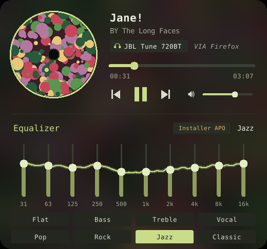
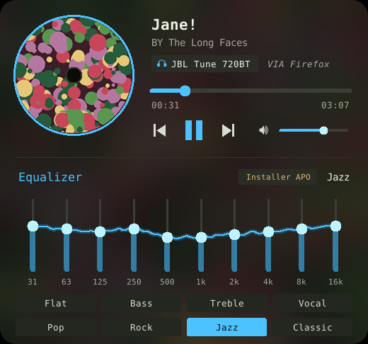

<div align="center">


# Mini Player

**Un lecteur de bureau élégant pour Windows 10/11, avec égaliseur 10 bandes.**
Il pilote la musique qui joue sur ton PC : Apple Music, Spotify, Deezer, YouTube dans le navigateur, VLC…




</div>

## Fonctionnalités

- 💿 **Pochette en vinyle** qui tourne pendant la lecture, fond flouté aux couleurs de l'album
- ⏯️ **Lecture / pause, précédent, suivant**, barre de progression cliquable
- 🔊 **Volume et mode muet de l'appli musicale uniquement** (le son du PC, Discord ou les jeux ne bougent pas)
- 🎚️ **Égaliseur 10 bandes** (31 Hz → 16 kHz) avec 8 presets animés : Flat, Bass, Treble, Vocal, Pop, Rock, Jazz, Classic
- 🎧 Affiche le **périphérique de sortie** et l'**appli source**
- 🎨 Suit la **couleur d'accentuation de Windows**, en direct
- ⌨️ **Alt + Retour arrière** pour masquer / afficher, avec animation façon macOS
- 🚀 **Démarre avec Windows**, une seule instance à la fois

## Installation

### Option 1 : télécharger l'exe (le plus simple)

1. Va dans **[Releases](../../releases/latest)** et télécharge `MiniPlayer.exe`.
2. Lance-le. Au premier lancement, Windows SmartScreen peut afficher un avertissement (l'exe n'est pas signé) : **Informations complémentaires → Exécuter quand même**.

### Option 2 : compiler soi-même

Il faut [Python 3.10+](https://www.python.org/downloads/) (cocher *Add to PATH*).

```bat
git clone https://github.com/<ton-pseudo>/mini-player.git
cd mini-player
build_exe.bat
```

Le script installe les dépendances et crée `Mini Player.exe` dans le dossier.

### Option 3 : lancer depuis le code

```bat
pip install -r requirements.txt
pythonw mini_player.pyw
```

## Égaliseur

L'égaliseur modifie le son de tout le PC grâce à **[Equalizer APO](https://sourceforge.net/projects/equalizerapo/)** (gratuit, open source). Pendant son installation, coche ton casque / tes enceintes, puis redémarre.

Sans Equalizer APO, l'égaliseur s'affiche mais ne change pas le son ; la pastille indique alors *Installer APO*.

Mini Player écrit ses réglages dans `config/mini_player_eq.txt` du dossier d'Equalizer APO et ajoute une ligne `Include:` dans `config.txt`.

## Utilisation

| Action | Comment |
|---|---|
| Masquer / afficher | **Alt + Retour arrière** (ou clic droit → Masquer) |
| Déplacer | Glisser une zone vide |
| Se déplacer dans le morceau | Cliquer sur la barre de progression |
| Volume de l'appli | Glisser le curseur ou molette ; clic sur le haut-parleur = muet |
| Régler une bande | Glisser, molette ; double-clic = remise à 0 |
| Options | Clic droit : premier plan, opacité, démarrage auto, couleur d'accent, quitter |

Le raccourci se change en haut de `mini_player.pyw` (`HOTKEY_MODS`, `HOTKEY_VK`).

## Questions fréquentes

**Le player reste sur « Rien en lecture ».**
L'appli musicale doit s'afficher dans les contrôles média de Windows. C'est le cas d'Apple Music (Microsoft Store), Spotify, Deezer, des navigateurs… mais **pas d'iTunes**.

**Le haut-parleur est grisé.**
Clique dessus : une fenêtre explique pourquoi et liste les applis qui produisent du son.

**Où sont les réglages ?**
`%USERPROFILE%\.mini_player.json` (position, égaliseur, options) et un journal de diagnostic dans `%USERPROFILE%\.mini_player.log`.

## Publier une nouvelle version

La GitHub Action compile l'exe à chaque push (artefact dans l'onglet *Actions*). Pour créer une Release :

```bash
git tag v1.0.0
git push --tags
```

## Licence

[MIT](LICENSE)
